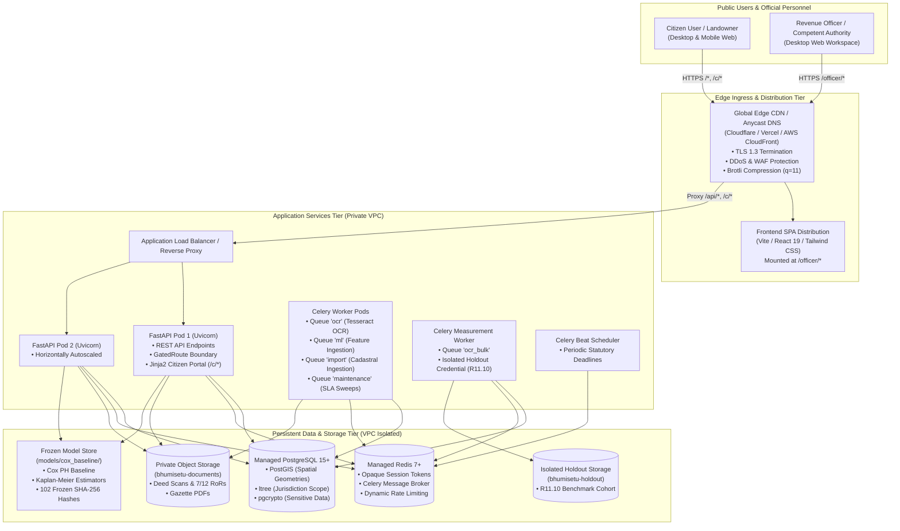

# BHUMISETU — Production Deployment Architecture

**Platform**: BHUMISETU National Land Acquisition Management & Decision Support Platform  
**Target Architecture**: Scalable, Multi-Tier, Zero-Trust Cloud Topology  

---

## 1. System Architecture Diagram

---

## 2. Ingress & Routing Specification

The edge ingress routes traffic between the static Single-Page Application (SPA) and the backend API container:

| Path Prefix | Target Service | Handler Type | Auth / Role Requirement | Notes |
| :--- | :--- | :--- | :--- | :--- |
| `/*` (Root) | Frontend / CDN | HTTP 302 Redirect | Public | Redirects to `/officer/` or citizen landing |
| `/officer/*` | Frontend SPA | Static Bundle | Officer Portal Client | Vite base `/officer/`; client-side RBAC routing |
| `/c/*` | Backend API | Jinja2 Server-Rendered | Public / Citizen Token | Lightweight citizen portal meeting 150 KB budget (R24.1) |
| `/api/auth/*` | Backend API | FastAPI Router | Public | Persona login and demo token exchange |
| `/api/citizen/*` | Backend API | FastAPI Router | Public / Citizen Token | **Redacted boundary**: PII and ML linear predictors masked |
| `/api/officer/*` | Backend API | FastAPI Router | Officer Bearer Token | Authenticated revenue officer endpoints |
| `/api/officer/survival-risk/*` | Backend API | FastAPI Router | Officer Bearer Token | Semi-parametric Cox ML predictions and hazard ratios |
| `/internal/*` | Backend API | FastAPI Router | Service Token (`JWT_SECRET`) | Internal microservice automation only |
| `/healthz` | Backend API | FastAPI Root | Public | Container orchestrator liveness probe |
| `/api/healthz` | Backend API | FastAPI Root | Public | API gateway readiness probe with version telemetry |

---

## 3. Network & Security Tier Boundaries

### 3.1 Zero-Trust Defense in Depth
1. **Public Edge**:
   - Only ports 80 (HTTP &rarr; HTTPS redirect) and 443 (HTTPS / HTTP/3 over QUIC UDP) are exposed to the public internet.
   - All cloud ingress terminates TLS 1.3 with automated certificate renewal.
2. **Private VPC Isolation**:
   - The FastAPI backend, Celery worker pods, managed PostgreSQL, and managed Redis instances reside within private subnets.
   - Direct public access to PostgreSQL (port 5432) and Redis (port 6379) is prohibited via security group firewalls.
3. **Session Security (Opaque Server-Side Tokens)**:
   - Officer and citizen sessions use opaque, cryptographically random 32-byte tokens stored in Redis (`SESSION_STORE_URL`).
   - Enables instant session revocation (R1.5) and dynamic role re-scoping (R2.6). JWTs are **never** used for end-user sessions.
4. **Service Token Separation**:
   - PyJWT with `JWT_SECRET` is restricted exclusively to inter-process service tokens on `/internal/*` (SEC-FIND-03).
5. **Cadastral & Data Privacy (DPDP Act 2023)**:
   - Landowner Aadhaar numbers, PAN cards, phone numbers, and compensation accounts are classified as `Sensitive` and redacted via `ResponseGate` for citizen views.
6. **Statutory Model Boundary (R11.10)**:
   - The holdout evaluation cohort (`bhumisetu-holdout`) is strictly isolated by S3 credential policy. `worker-ocr` holds no credentials for this bucket, preventing training/tuning data leakage into the evaluation cohort.

---

## 4. Scalability, Resilience & Fail-Closed Behavior

* **Stateless API Tier**:
  - FastAPI replicas are stateless and horizontally autoscaled based on CPU/RAM thresholds or request concurrency.
* **Asynchronous Decoupling**:
  - CPU-intensive optical character recognition (OCR) and high-volume cadastral imports are handled asynchronously by Celery workers, ensuring the API retains sub-50ms HTTP response latencies.
* **Deterministic Frozen Inference**:
  - The Cox Proportional Hazards baseline models are read-only and loaded directly from disk (`models/cox_baseline`). No GPU hardware, network calls, or external SaaS dependencies are required during inference.
* **Fail-Closed Statutory Engine**:
  - If boundary overlap checks, objection status validations, or required statutory notices are incomplete, workflow progression is rejected with HTTP 422. No operation "fails open".
